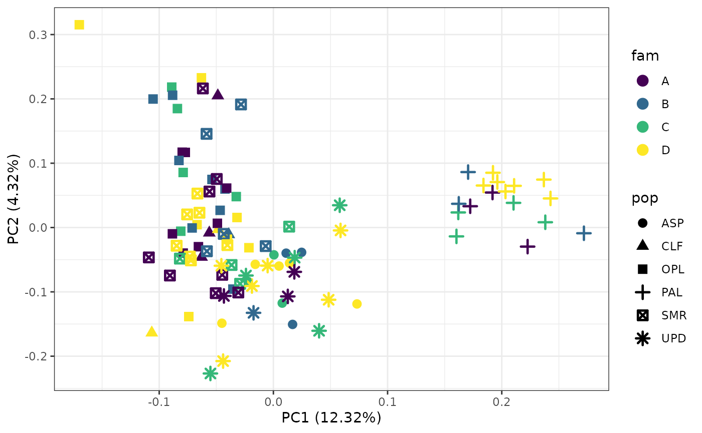
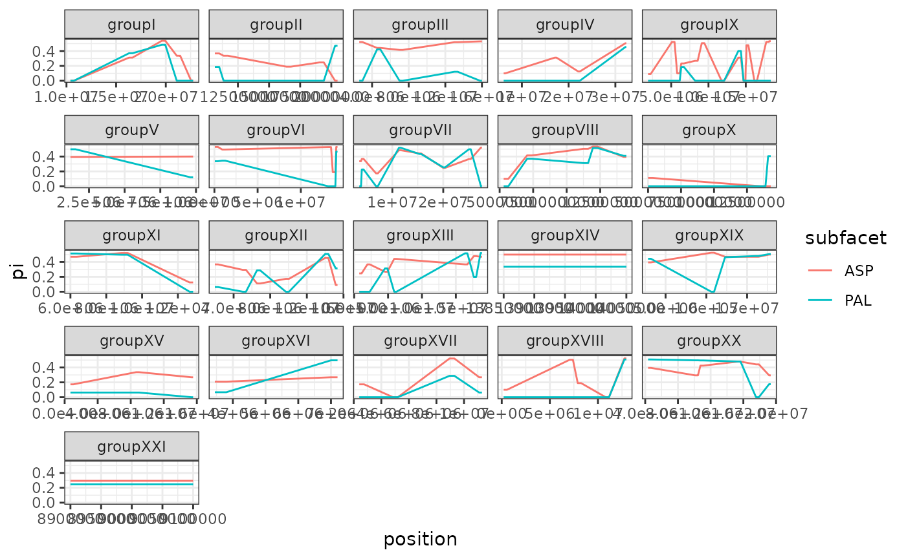
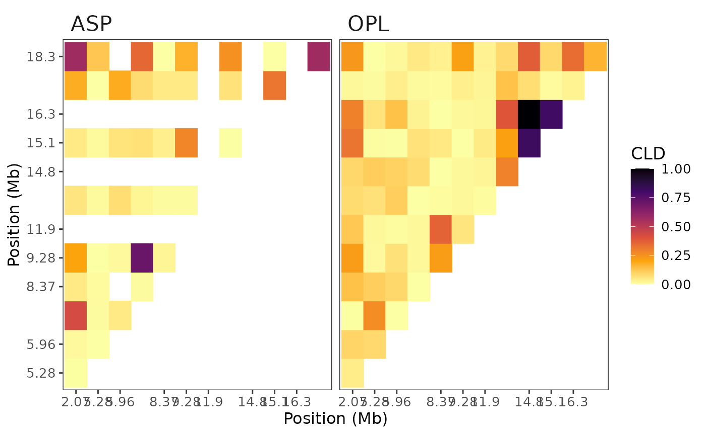
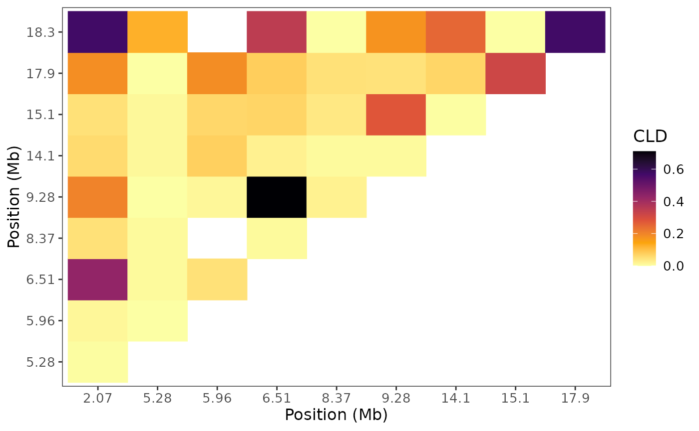

# Introduction to Basic SNP Analysis with snpR

## snpR Introduction

snpR is a SNP genomic analysis package that is designed to do a range of
basic genomic analyses, such as calculate observed and expected
heterozygosity, linkage disequilibrium, pairwise-Fst, and so on. This
package also has dimensionality reduction tools (eg. PCA, tsne, umap),
data formatting conversions for other packages and programs, population
structure, genetic prediction, private allele detection and more (See
documentation for details). All functions are written to take similar
arguments and interpret them in consistent ways. This is done through
the use of the snpRdata object class, which all snpR functions take as
their first argument. Nearly all functions are written to be overwrite
safe: the object provided to the function should be overwritten by the
output. Newly calculated statistics will simply be merged-in to the
existing object.

A fundamental feature of snpR is the use of *facets*. Facets define
categorical metadata features of the data, and can reference either
features describing individual SNPs (such as chromosome) or individual
samples (such as population). Facets are used to automatically break
apart input data to calculate statistics in intuitive ways, such as by
calculating observed heterozygosity in each population. Since metadata
is contained in the snpRdata object, the user will never need to
manually subset or loop calculations across categories/levels of a
facet. Further, facets can be combined so that many calculations occur
across these groups with just one command. Facets are combined using “.”
argument (Examples are provided below). Further information on facets is
provided later in this guide.

## Quick-start Guide

Here, we will walk through a basic analysis of the example three-spined
stickleback data included in this package (stickSNPs). We will filter
SNP data, make a PCA exploratory plot, use a clustering algorithm
(tSNE), calculate minor allele frequencies, $`\pi`$, observed
heterozygosity, see if SNPs are in HWE, check for private alleles,
calculate pairwise FST, gaussian smooth and plot these parameters,
calculate pairwise LD in two populations on one chromosome, and run
through a Genome Wide Association example.

### Data import

snpR can take a variety of SNP data formats. The basic input format is a
tab-delimited SNP dataset, where each row contains metadata and
genotypes for a single SNP. Genotypes are noted with two characters,
such as “GG” or “GA” for a G/G homozygote and a G/A heterozygote,
respectively. The missing data format can be user-defined, but is “NN”
by default. For example, see the stick_NN_input.txt distributed with
this package.

``` r

NNfile <- system.file("extdata", "stick_NN_input.txt", package = "snpR")
```

Note that this is identical to the format output by, for example, the
ANGSD software package. Ensure that genotypes are not stored as factors
during import. The resulting data looks like:

    ##       chr position ASP.r2.141 ASP.r2.144 ASP.r2.146 ASP.r2.147
    ## 1  groupI 10593829         GG         GG         GG         GG
    ## 2  groupI 16498302         TT         TT         CT         TT
    ## 3  groupI 19759331         AA         NN         GG         NN
    ## 4  groupI 21284266         GG         GG         GG         NN
    ## 5  groupI 22746027         GG         GG         GG         GG
    ## 6 groupII 10829169         CC         CC         CC         CG

Note that snpR can also import data where genotypes are stored as four
numbers (ex. “GG”, “GA”, and “NN” as “0101”, “0102”, and “0000”,
respectively), and as a single numeric character that represents the
count of the minor allele (0 or 2 for homozygotes, 1 for heterozygotes).

Data in the “NN” format, as shown above, can be imported directly into a
snpRdata set alongside any corresponding metadata using import.snpR.data
function:

``` r

# the first three characters of the column names are the population, so let's grab that.
# since the first three columns contain snp.metadata, we need to remove those before import!
sample_meta <- data.frame(pop = substr(colnames(NN[-c(1:2)]), 1, 3), stringsAsFactors = F)

# grab our sample metadata
snp_meta <- NN[,1:2]

# grab the genetic data
gen_data <- NN[,3:ncol(NN)]

# import, remember to remove metadata from the genotypes!
my.dat <- import.snpR.data(genotypes = gen_data, 
                           snp.meta = snp_meta, 
                           sample.meta = sample_meta)
```

Note:

- Column names in the snp and sample metadata must be unique (no repeats
  across *both* metadata sets), and cannot contain ‘.’, ‘~’, or
  whitespace!

- Some functions expect to see columns named ‘chr’ and ‘position’.
  Ensuring snp.meta has these columns early on saves some potential
  column renaming later.

- Shared metadata levels across different columns can cause issues if
  statistics are calculated for both of the two categories (for example,
  if both a population and a family are both named “A”).

- If you have existing objects in the *adegenet* genind or genlight
  format, the vcfR format, or a vcf file, plink files, FSTAT file, or
  genepop file, these can also be automatically imported! Look for the
  “read_vcf()” or “convert_genind()” style functions.

- Most delimited genotype formats (such as NN or 0000) can also be
  automatically imported with the read_delimited_snps() function.

``` r

my.dat2 <- read_delimited_snps(NNfile, sample.meta = sample_meta, header_cols = 2)
identical(my.dat, my.dat2)
```

    ## [1] TRUE

### snpRdata objects and facets

#### snpRdata objects

snpRdata objects store a range of variables internally in order to
minimize repeat computation of things like allele frequencies.

Calling a snpRdata object will show a summary of the calculations done
on the object and the metadata categories available.

``` r

my.dat
```

By and large, snpRdata objects should be accessed via accessor
functions:

``` r

# get the number of samples
nsamps(my.dat)
```

    ## [1] 100

``` r

ncol(my.dat)
```

    ## [1] 100

``` r

# get the number of SNPs
nsnps(my.dat)
```

    ## [1] 100

``` r

nrow(my.dat)
```

    ## [1] 100

``` r

# dim also works
dim(my.dat)
```

    ## [1] 100 100

``` r

# view sample metadata
head(sample.meta(my.dat))
```

    ##   pop .sample.id
    ## 1 ASP          1
    ## 2 ASP          2
    ## 3 ASP          3
    ## 4 ASP          4
    ## 5 ASP          5
    ## 6 ASP          6

``` r

# write to sample metadata; note that writing to any part of the metadata or genotypes will cause any calculations
# to be discarded, since the new columns can cause some unexpected results.
sample.meta(my.dat)$fam <- sample(LETTERS[1:4], nsamps(my.dat), T)

# view snp metadata
head(snp.meta(my.dat))
```

    ##          chr position .snp.id
    ## 1    groupVI   212436       1
    ## 2 groupXVIII   350070       2
    ## 3    groupXV   854285       3
    ## 4  groupXIII   907279       4
    ## 5    groupVI  1068620       5
    ## 6     groupV  1392753       6

``` r

# write to sample metadata; note that writing to any part of the metadata or genotypes will cause any calculations
# to be discarded, since the new columns can cause some unexpected results.
snp.meta(my.dat)$new_snp_col <- sample(LETTERS[1:6], nsnps(my.dat), T)
```

    ## Warning in validityMethod(object): Some levels are duplicated across multiple sample meta facets.
    ## This will cause issues if those sample facets are run during analysis.
    ## Issues:
    ## 
    ## Level: A in facets: fam, new_snp_col
    ## Level: B in facets: fam, new_snp_col
    ## Level: C in facets: fam, new_snp_col
    ## Level: D in facets: fam, new_snp_col

``` r

snp.meta(my.dat)$new_snp_col <- NULL

# view genotypes, can be written to as above
genotypes(my.dat)[1:6, 1:6]
```

    ##   ASP.r2.141 ASP.r2.144 ASP.r2.146 ASP.r2.147 ASP.r2.196 ASP.r2.216
    ## 1         AG         GG         AA         AA         NN         AG
    ## 2         GG         GG         GG         GG         GT         GG
    ## 3         CC         CC         CC         CC         CC         CC
    ## 4         AA         AA         AA         AA         AG         AA
    ## 5         GG         NN         NN         AA         GG         AG
    ## 6         AC         AC         AA         AA         AA         AC

snpRdata objects can be subset using the usual bracket operators,
specifying first the snps to keep, then the samples to keep:

``` r

sub1 <- my.dat[1:10,]
nsnps(sub1)
```

    ## [1] 10

``` r

sub2 <- my.dat[,1:10]
nsamps(sub2)
```

    ## [1] 10

Almost all snpR functions are built to allow overwriting for easy object
management. Since calculated data is stored in snpRdata objects, snpR
functions generally return the snpRdata object that was given to them,
but with extra data merged in. For example, to calculate observed
heterozygosity, the calc_ho function can be used:

``` r

# calculate observed heterozygosity, overwriting the my.dat object
my.dat <- calc_ho(my.dat)
```

Calculated statistics can be fetched using the get.snpR.stats accessor
function. Note that this function returns a data.frame or nested list
(depending on the requested stats), not a snpRdata object, and *should
never be used to overwrite a snpRdata object!*. Since some calculations
are run pairwise you need to specify if you want the pairwise or single
stats returned.

get.snpR.stats will automatically return multiple types of data if it is
available. Typically, this is the statistic calculated both within each
individual snp and the weighted averages within populations (or facet
levels).

``` r

# fetch calculated statistics
ho <- get.snpR.stats(my.dat, stats = "ho")
head(ho$single)
```

    ##   facet subfacet        chr position .snp.id         ho
    ## 1 .base    .base    groupVI   212436       1 0.47674419
    ## 2 .base    .base groupXVIII   350070       2 0.06451613
    ## 3 .base    .base    groupXV   854285       3 0.13541667
    ## 4 .base    .base  groupXIII   907279       4 0.44318182
    ## 5 .base    .base    groupVI  1068620       5 0.38983051
    ## 6 .base    .base     groupV  1392753       6 0.35483871

``` r

head(ho$weighted.means)
```

    ##   facet subfacet snp.facet snp.subfacet weighted_mean_ho
    ## 1 .base    .base     .base        .base        0.3171868

#### Facets

Facets are a fundamental feature of snpR. Often, SNP data must be
separated by population/chromosome/family/year etc. before statistics
are calculated. Additionally, many statistics, like Fst, need to be
calculated *pairwise* by comparing each population to every other
population. Facets allow you to easily do this without the need for
direct data manipulation.

##### Basic Facets

Facets are defined by reference to column names in either the snp or
sample metadata that was provided when creating a snpRdata object. For
example, the facet “pop” would split my.dat apart by the pop column in
the sample metadata and run the requested function or calculation for
each of the levels/subfacets within that facet (eg. the facet pop
comprises 6 levels/subfacets - ASP, CLF, OPL, PAL, SMR, UPD). Whereas
the facet “chr” would split my.dat apart by the “chr” column in the snp
metadata (21 levels/subfacets) and run any specified calculation for
each unique level/subfacet.

To calculate observed heterozygosity at each SNP within each population,
for example, one can supply the “pop” facet.

``` r

my.dat <- calc_ho(my.dat, facets = "pop") #running the calculation
head(get.snpR.stats(my.dat, facets = "pop", stats = "ho")$weighted.means) #retrieving the results
```

    ##   facet subfacet snp.facet snp.subfacet weighted_mean_ho
    ## 1   pop      ASP     .base        .base        0.3419156
    ## 2   pop      CLF     .base        .base        0.2970480
    ## 3   pop      OPL     .base        .base        0.3446866
    ## 4   pop      PAL     .base        .base        0.2136752
    ## 5   pop      SMR     .base        .base        0.3265910
    ## 6   pop      UPD     .base        .base        0.3660377

##### Complex Facets

Facets can define more than one column at once, in which case the data
is split by *both* columns! Within a single facet, column names are
separated by a ‘.’. For example, if there was both a pop and fam (or
family) column in the sample metadata, the facet “pop.fam” would split
by both the pop and the fam columns simultaneously, so it would have
categories like “popA.famB” for an individual from population A, family
B. These “complex” facets can also note both SNP and sample-specific
categories simultaneously, for example, “pop.chr” would split the data
by the pop column in the sample metadata and the chr column in the SNP
metadata simultaneously.

``` r

my.dat <- calc_ho(my.dat, "pop.fam") #running the calculation
head(get.snpR.stats(my.dat, "pop.fam", stats = "ho")$weighted.means) #retrieving the results
```

    ##     facet subfacet snp.facet snp.subfacet weighted_mean_ho
    ## 1 fam.pop    A.CLF     .base        .base        0.3111111
    ## 2 fam.pop    A.OPL     .base        .base        0.3387387
    ## 3 fam.pop    A.PAL     .base        .base        0.2095588
    ## 4 fam.pop    A.SMR     .base        .base        0.3353293
    ## 5 fam.pop    A.UPD     .base        .base        0.4038462
    ## 6 fam.pop    B.ASP     .base        .base        0.3609023

The order of the categories given in a facet do not matter–“pop.chr”
will produce the same result as “chr.pop”.

##### Multiple facets

Most functions can also take several facets at once, given as a
character vector. For example, to split by both population, then by
population and chr simultaneously, c(“pop”, “pop.chr”) could be given.

``` r

my.dat <- calc_ho(my.dat, c("pop.fam", "pop"))
head(get.snpR.stats(my.dat, c("pop.fam", "pop"), stats = "ho")$weighted.means) # will show both facets, but it's a pretty large dataset.
```

    ##     facet subfacet snp.facet snp.subfacet weighted_mean_ho
    ## 1 fam.pop    A.CLF     .base        .base        0.3111111
    ## 2 fam.pop    A.OPL     .base        .base        0.3387387
    ## 3 fam.pop    A.PAL     .base        .base        0.2095588
    ## 4 fam.pop    A.SMR     .base        .base        0.3353293
    ## 5 fam.pop    A.UPD     .base        .base        0.4038462
    ## 6 fam.pop    B.ASP     .base        .base        0.3609023

``` r

tail(get.snpR.stats(my.dat, c("pop.fam", "pop"), stats = "ho")$weighted.means) # both facets are contained in the dataset.
```

    ##    facet subfacet snp.facet snp.subfacet weighted_mean_ho
    ## 23   pop      ASP     .base        .base        0.3419156
    ## 24   pop      CLF     .base        .base        0.2970480
    ## 25   pop      OPL     .base        .base        0.3446866
    ## 26   pop      PAL     .base        .base        0.2136752
    ## 27   pop      SMR     .base        .base        0.3265910
    ## 28   pop      UPD     .base        .base        0.3660377

A handful of functions only work with either SNP or sample specific
facets, but this is fixed “under the hood.” For example, since observed
heterozygosity is calculated independently for each SNP, it makes no
sense to calculate it split up by chromosome. Using the “pop.chr” facet
with calc_ho, therefore, will internally default to “pop”.

However, weighted means are still calculated for each possible category!

``` r

# same as just doing "pop" as a facet.
my.dat <- calc_ho(my.dat, "pop.chr") 
head(get.snpR.stats(my.dat, "pop.chr", stats = "ho")$weighted.means)
```

    ##   facet subfacet snp.facet snp.subfacet weighted_mean_ho
    ## 1   pop      ASP       chr       groupI        0.2200000
    ## 2   pop      ASP       chr      groupII        0.2400000
    ## 3   pop      ASP       chr     groupIII        0.5000000
    ## 4   pop      ASP       chr      groupIV        0.2564103
    ## 5   pop      ASP       chr      groupIX        0.3076923
    ## 6   pop      ASP       chr       groupV        0.5000000

``` r

head(get.snpR.stats(my.dat, "pop.chr", stats = "ho")$single)
```

    ##   facet subfacet     chr position .snp.id        ho
    ## 1   pop      ASP groupVI   212436       1 0.3333333
    ## 2   pop      CLF groupVI   212436       1 0.6000000
    ## 3   pop      OPL groupVI   212436       1 0.6500000
    ## 4   pop      PAL groupVI   212436       1 0.2941176
    ## 5   pop      SMR groupVI   212436       1 0.4545455
    ## 6   pop      UPD groupVI   212436       1 0.5384615

Most of the time, giving NULL (the usual default) to a facets argument
will run the data without splitting it up at all. Resulting stats will
belong to the “.base” facet, a special, internally used facet that
implies no splitting! Giving “all” to a facets argument, on the other
hand, will run the data splitting by all previously run facets!

``` r

# same as just doing "pop" as a facet.
my.dat <- calc_ho(my.dat) 
head(get.snpR.stats(my.dat, ".base", stats = "ho")$weighted.mean)
```

    ##   facet subfacet snp.facet snp.subfacet weighted_mean_ho
    ## 1 .base    .base     .base        .base        0.3171868

#### Facet subsetting

snpR objects can also be subset using facets by supplying the facet name
and the levels to keep or remove:

``` r

sub3 <- my.dat[pop = "ASP"]
head(sample.meta(sub3))
```

    ##   pop fam .sample.id
    ## 1 ASP   D          1
    ## 2 ASP   D          2
    ## 3 ASP   D          3
    ## 4 ASP   C          4
    ## 5 ASP   D          5
    ## 6 ASP   B          6

Complex facets are specified the same way. Note that the order of the
levels and facets must be consistent:

``` r

sub4 <- my.dat[pop.fam = "ASP.D"]
head(sample.meta(sub4))
```

    ##   pop fam .sample.id
    ## 1 ASP   D          1
    ## 2 ASP   D          2
    ## 3 ASP   D          3
    ## 5 ASP   D          5
    ## 8 ASP   D          8

``` r

# sub5 <- my.dat[pop.fam = "D.ASP"] # won't work
```

You can filter by multiple facets and facet levels at once:

``` r

sub5 <- my.dat[pop = c("ASP", "PAL"), chr = "groupIX"]
dim(sub5)
```

    ## [1] 13 28

You can also use negative sub-setting:

``` r

sub6 <- my.dat[pop = -c("ASP", "PAL")]

unique(sample.meta(sub6)$pop)
```

    ## [1] "CLF" "OPL" "SMR" "UPD"

### SNP filtering

The filter_snps function can be used to filter poorly sequenced
individuals and loci, remove SNPs with a low minor allele frequency
either overall or by facet (often population), remove highly
heterozygous SNPs (which are likely sourced from duplicated genomic
regions), and remove non-biallelic SNPs.

Here, we will filter out all loci with a minor allele frequency below
0.05 in all populations, loci with a heterozygote frequency above 0.55,
that are not bi-allelic, that are non-polymorphic, or that are sequenced
in less than half of the individuals. We will also remove all
individuals that are genotyped at less than half of the remaining loci,
then quickly re-check that all loci are still polymorphic.

``` r

my.dat <- filter_snps(x = my.dat,
                         maf = 0.05, # what is the minimum minor allele frequency to keep?
                         hf_hets = 0.55, # what is the maximum heterozygote frequency to keep?
                         min_ind =  0.5, # remove all loci sequenced at less than half of the individuals.
                         min_loci = 0.5, # remove all individuals sequenced at less than half of the loci
                         re_run = "partial", # tell filter_snps to recheck that all loci are polymorphic after removing individuals. Could set to "full" to re-check maf and heterozygote frequency, or FALSE to skip.
                         maf_facets = "pop", # we want to keep any SNPs that pass the maf filter in ANY population!
                         non_poly = TRUE, # we want to remove non-polymorphic loci
                         bi_al = TRUE) # we want to remove non bi-allelic loci") # missing genotypes are listed as "NN"
```

Note that we use the facet notation defined above to define maf.facets.

### PCA plots

A common first analytical step for new data is to run a PCA to look for
any evidence of population structure/sequencing errors. snpR has a
function to do this in a streamlined way.

Note:

- A PCA cannot be constructed with missing data, so we interpolate with
  the average number of each allele across all individuals as the
  default (“bernoulli”). There are other interpolation methods available
  in this package (see plot_clusters documentation for more details).
  \*The PCA plotting function can work with a column of population IDs
  (as well as one additional info column, such as sex). The stickSNPs
  dataset has an additional sample metadata column called “fam”, which
  relates to family, so we’ll use that. If you recall, “fam” was created
  earlier for my.dat in the snpRdata objects section.

``` r

head(sample.meta(my.dat))
```

    ##   pop fam .sample.id
    ## 1 ASP   D          1
    ## 2 ASP   D          2
    ## 3 ASP   D          3
    ## 4 ASP   C          4
    ## 5 ASP   D          5
    ## 6 ASP   B          6

To run a PCA we can use the plot_clusters function. Note that this
function, like all other snpR plotting functions, **does not return a
snpRdata object** and we should **not overwrite our data!** so, save it
to a new variable.

``` r

# generate both tSNE and PCA plots
p <- plot_clusters(my.dat, facets = c("pop.fam"))
```

To view the plots, we can call the object under the “plots” element in
the list that plot_clusters returned.

``` r

# View the PCA
p$plots$pca
```



plot_clusters also returns the raw plot data under the data element.

plot_clusters also supports a few other plotting tools (UMAP and tSNE),
but these are not currently recommended due to reproducibility issues.

Tip: you can specify viridis palette option for your plot! Or, if you
want more customization, save the data to a new object and use your
preferred plotting library package. For example:

``` r

a <- p$data$pca
ggplot2::ggplot(a, aes(PC1, PC2, color=pop)) + geom_point() # a simple example
```

### Calculate minor allele frequencies, $`\pi`$, Ho, check for private alleles and HWE.

Minor allele frequencies, $`\pi`$, Ho, the number of private alleles,
and HWE divergence, and other basic diversity statistics are easy to
calculate with snpR. Each use a very similar function, which takes
identical arguments. Since each returns a copy of the input snpRdata
object, but with new information merged in, we can safely overwrite the
original object each time we use these functions.

Each of these functions, like most functions, take a snpRdata object and
facets as their first two arguments. Here, we’ll use the my.dat object
and calculate various statistics splitting the dataset by pop.

``` r

# calculate minor allele frequencies, pi, ho, check for private alleles and HWE.
my.dat <- calc_maf(my.dat, "pop")
my.dat <- calc_pi(my.dat, "pop")
my.dat <- calc_ho(my.dat, "pop")
my.dat <- calc_private(my.dat, "pop")
my.dat <- calc_hwe(my.dat, "pop")
```

We can then use get.snpR.stats to view the results!

``` r

# using the "all" facet requests statistics for all facets that have been run.
stats <- get.snpR.stats(my.dat, "pop", stats = c("maf", "pi", "ho", "private", "hwe")) 

head(stats$single)[,6:10]
```

    ##         maf maj.count major min.count minor
    ## 1 0.5000000         9     G         9     A
    ## 2 0.7000000         3     G         7     A
    ## 3 0.5750000        17     G        23     A
    ## 4 0.2058823        27     G         7     A
    ## 5 0.5909091        18     G        26     A
    ## 6 0.5000000        13     G        13     A

### Pairwise Fst calculation

snpR can calculate pairwise Fst using a few approaches. Here, we’ll use
Wier and Cockerham (1984)’s method to calculate pairwise Fst between
each pair of populations for each SNP.

``` r

my.dat <- calc_pairwise_fst(my.dat, "pop", method = "WC")
```

To recover the data, we again use get.snpR.stats. We get a new kind of
output here: fst.matrix, which will show a matrix of fst scores across
comparisons!

``` r

stats <- get.snpR.stats(my.dat, "pop", stats ="fst")

head(stats$fst.matrix$pop)
```

    ## Key: <p1>
    ##        p1      CLF        OPL       PAL        SMR          UPD
    ##    <fctr>    <num>      <num>     <num>      <num>        <num>
    ## 1:    ASP 0.030338 0.04646719 0.1712883 0.03648554 -0.006983092
    ## 2:    CLF       NA 0.03896661 0.2846742 0.03729842  0.033546407
    ## 3:    OPL       NA         NA 0.2414295 0.01030270  0.040228728
    ## 4:    PAL       NA         NA        NA 0.23150253  0.168629980
    ## 5:    SMR       NA         NA        NA         NA  0.030431574

### Gaussian Smoothing

snpR has a tool to make sliding window averages for parameters using a
Gaussian kernel, splitting by any number of different variables. Here,
we’ll smooth $`\pi`$, Ho, and pairwise Fst, splitting by population. In
addition, we’ll weight the contribution of each SNP to each window by
the number of times that SNP was sequenced across individuals.

To calculate sliding window averages, we need to define the sizes of the
windows and the distance we slide between each. These are defined by the
“sigma” and “step” arguments, respectively. Each window will include all
SNPs within 3 x sigma of the window center, after which their
contribution to the window average is small enough to be negligible.
Both sigma and step are defined in *kilobases*.

Note that snpR looks for a column titled “position” in the SNP metadata
when smoothing. This column should contain the position of each SNP in
bp on the scaffold/chromosome/etc.

By default, snpR will calculate sliding window averages for all
previously calculated stats. The “stats.type” argument can be used to
limit this to just single ($`\pi`$, Ho, etc) or pairwise stats (Fst).
Note that individual stats cannot be specified, since the computational
gain in running only one or two stats is minimal, so only the
“pairwise”, “single” or c(“pairwise”, “single”) stats.type options are
allowed.

If you have many different facet combinations and a large dataset, this
may take a while, so we’ll run it only for one population.

``` r

sub7 <- my.dat[pop = c("ASP", "PAL")]
sub7 <- calc_pi(sub7, "pop")
sub7 <- calc_pairwise_fst(sub7, "pop")
sub7 <- calc_smoothed_averages(x = sub7, facets = "pop.chr",
                                 sigma = 200, # using a window size of 200
                                 step = 50) # using a step size of 50 between windows
```

We could run
[`calc_smoothed_averages()`](https://hemstrow.github.io/snpR/reference/calc_smoothed_averages.md)
faster using the `par` argument if we chose to!

We can view the results with get.snpR.stats as usual! We can then look
at the `single.window` and `pairwise.window` outputs to see our results.

``` r

stats <- get.snpR.stats(sub7, facets = "pop.chr", stats = c("pi", "fst"))

head(stats$single.window)
```

    ##   facet subfacet snp.facet snp.subfacet position sigma step nk.status gaussian
    ## 1   pop      ASP       chr      groupVI    50000   200   50      TRUE     TRUE
    ## 2   pop      PAL       chr      groupVI    50000   200   50      TRUE     TRUE
    ## 3   pop      ASP       chr      groupVI   100000   200   50      TRUE     TRUE
    ## 4   pop      PAL       chr      groupVI   100000   200   50      TRUE     TRUE
    ## 5   pop      ASP       chr      groupVI   150000   200   50      TRUE     TRUE
    ## 6   pop      PAL       chr      groupVI   150000   200   50      TRUE     TRUE
    ##   n_snps triple_sigma        pi
    ## 1      1        FALSE 0.5294118
    ## 2      1        FALSE 0.3368984
    ## 3      1        FALSE 0.5294118
    ## 4      1        FALSE 0.3368984
    ## 5      1        FALSE 0.5294118
    ## 6      1        FALSE 0.3368984

``` r

head(stats$pairwise.window)
```

    ##   facet subfacet snp.facet snp.subfacet position sigma step nk.status gaussian
    ## 1   pop  ASP~PAL       chr      groupVI    50000   200   50      TRUE     TRUE
    ## 2   pop  ASP~PAL       chr      groupVI   100000   200   50      TRUE     TRUE
    ## 3   pop  ASP~PAL       chr      groupVI   150000   200   50      TRUE     TRUE
    ## 4   pop  ASP~PAL       chr      groupVI   200000   200   50      TRUE     TRUE
    ## 5   pop  ASP~PAL       chr   groupXVIII   200000   200   50      TRUE     TRUE
    ## 6   pop  ASP~PAL       chr      groupVI   250000   200   50      TRUE     TRUE
    ##   n_snps triple_sigma        fst
    ## 1      1        FALSE 0.13801803
    ## 2      1        FALSE 0.13801803
    ## 3      1        FALSE 0.13801803
    ## 4      1        FALSE 0.13801803
    ## 5      1        FALSE 0.02848134
    ## 6      1        FALSE 0.13801803

### Plot the Smoothed Parameters

Next, we want to plot these variables. We’ll use the ggplot2 package,
and start with $`\pi`$:

``` r

stats <- get.snpR.stats(x = sub7, facets = "pop.chr", stats = "pi")$single.window

# Plot pi, pi works the same way!
ggplot(stats, aes(x = position, y = pi, color = subfacet)) + geom_line() + theme_bw() +
  facet_wrap(~snp.subfacet, scales = "free_x") # facet wrap on chr to split by linkage chr/chromosome.
```



### Calculate Pairwise LD

Now, we’ll calculate pairwise LD for one population. We’ll use Burrow’s
Composite Linkage Disequilibrium as our measure of LD, since it runs
quickly. Several other options are also available (for more details see
the documentation). We can specify that we want to split by linkage
groups/chromosomes, as usual. This will produce two outputs: a proximity
table and a matrix of pairwise LD for each level for each statistic.

Since LD comparisons take a while, it can be worthwhile to run only a
few different categories of a given facet. The snpR LD function can do
this with the “subfacet” argument. This argument takes a named list,
where each entry contains the categories to run for a specific facet.
For example:

``` r

list(pop = "ASP", chr = "groupIX") #
```

would run the ASP population for the groupIX chromosome, whereas

``` r

list(pop = c("SMR", "OPL"), chr = c("groupIX", "groupIV"))
```

    ## $pop
    ## [1] "SMR" "OPL"
    ## 
    ## $chr
    ## [1] "groupIX" "groupIV"

would run the SMR and OPL populations for the group IX and IV
chromosomes. We can use complex (multi-category) facets as normal, so

``` r

list(fam.pop = "A.ASP")
```

    ## $fam.pop
    ## [1] "A.ASP"

would run only samples in family A and the ASP population.

In this case, let’s run the ASP and OPL populations for groupIX:

``` r

my.dat <- calc_pairwise_ld(my.dat, facets = "chr.pop", 
                           subfacets =  list(pop = c("ASP", "OPL"), chr = "groupIX"))
```

The results can be accessed as usual, although they are in a slightly
different format!

``` r

stats <- get.snpR.stats(x = my.dat, facets = "chr.pop", stats = "ld")

str(stats)
```

    ## List of 1
    ##  $ LD:List of 2
    ##   ..$ prox    :Classes 'data.table' and 'data.frame':    121 obs. of  11 variables:
    ##   .. ..$ s1_chr         : chr [1:121] "groupIX" "groupIX" "groupIX" "groupIX" ...
    ##   .. ..$ s1_position    : num [1:121] 2075079 2075079 5287711 2075079 5287711 ...
    ##   .. ..$ s1_.snp.id     : int [1:121] 7 7 22 7 22 24 7 22 28 7 ...
    ##   .. ..$ s2_chr         : chr [1:121] "groupIX" "groupIX" "groupIX" "groupIX" ...
    ##   .. ..$ s2_position    : num [1:121] 5287711 5960933 5960933 6515796 6515796 ...
    ##   .. ..$ s2_.snp.id     : int [1:121] 22 24 24 28 28 28 36 36 36 41 ...
    ##   .. ..$ proximity      : num [1:121] 3212632 3885854 673222 4440717 1228085 ...
    ##   .. ..$ CLD            : num [1:121] 0.00284 0.01235 0 0.42857 0.00833 ...
    ##   .. ..$ sample.facet   : chr [1:121] "pop" "pop" "pop" "pop" ...
    ##   .. ..$ sample.subfacet: chr [1:121] "ASP" "ASP" "ASP" "ASP" ...
    ##   .. ..$ S              : num [1:121] 9 10 8 8 7 8 10 8 7 11 ...
    ##   .. ..- attr(*, ".internal.selfref")=<pointer: 0x5ff937165190> 
    ##   ..$ matrices:List of 2
    ##   .. ..$ ASP:List of 1
    ##   .. .. ..$ groupIX:List of 2
    ##   .. .. .. ..$ CLD: num [1:13, 1:13] NA NA NA NA NA NA NA NA NA NA ...
    ##   .. .. .. .. ..- attr(*, "dimnames")=List of 2
    ##   .. .. .. .. .. ..$ : chr [1:13] "2075079" "5287711" "5960933" "6515796" ...
    ##   .. .. .. .. .. ..$ : chr [1:13] "2075079" "5287711" "5960933" "6515796" ...
    ##   .. .. .. ..$ S  : num [1:13, 1:13] NA NA NA NA NA NA NA NA NA NA ...
    ##   .. .. .. .. ..- attr(*, "dimnames")=List of 2
    ##   .. .. .. .. .. ..$ : chr [1:13] "1" "2" "3" "4" ...
    ##   .. .. .. .. .. ..$ : chr [1:13] "1" "2" "3" "4" ...
    ##   .. ..$ OPL:List of 1
    ##   .. .. ..$ groupIX:List of 2
    ##   .. .. .. ..$ CLD: num [1:13, 1:13] NA NA NA NA NA NA NA NA NA NA ...
    ##   .. .. .. .. ..- attr(*, "dimnames")=List of 2
    ##   .. .. .. .. .. ..$ : chr [1:13] "2075079" "5287711" "5960933" "6515796" ...
    ##   .. .. .. .. .. ..$ : chr [1:13] "2075079" "5287711" "5960933" "6515796" ...
    ##   .. .. .. ..$ S  : num [1:13, 1:13] NA NA NA NA NA NA NA NA NA NA ...
    ##   .. .. .. .. ..- attr(*, "dimnames")=List of 2
    ##   .. .. .. .. .. ..$ : chr [1:13] "1" "2" "3" "4" ...
    ##   .. .. .. .. .. ..$ : chr [1:13] "1" "2" "3" "4" ...

The results are a multi-level named list. The first level references
“prox” and “matrices”. “prox” is fairly straightforward:

``` r

head(stats$LD$prox)
```

    ##     s1_chr s1_position s1_.snp.id  s2_chr s2_position s2_.snp.id proximity
    ##     <char>       <num>      <int>  <char>       <num>      <int>     <num>
    ## 1: groupIX     2075079          7 groupIX     5287711         22   3212632
    ## 2: groupIX     2075079          7 groupIX     5960933         24   3885854
    ## 3: groupIX     5287711         22 groupIX     5960933         24    673222
    ## 4: groupIX     2075079          7 groupIX     6515796         28   4440717
    ## 5: groupIX     5287711         22 groupIX     6515796         28   1228085
    ## 6: groupIX     5960933         24 groupIX     6515796         28    554863
    ##            CLD sample.facet sample.subfacet     S
    ##          <num>       <char>          <char> <num>
    ## 1: 0.002840909          pop             ASP     9
    ## 2: 0.012345679          pop             ASP    10
    ## 3: 0.000000000          pop             ASP     8
    ## 4: 0.428571429          pop             ASP     8
    ## 5: 0.008333333          pop             ASP     7
    ## 6: 0.047619048          pop             ASP     8

Each row contains information on one single SNP-SNP comparison, with
information on the group and population of the comparison, as well as
the positions of the SNPs, their proximity to each other, and the LD
statistics.

The “matrices” object is another multi-level list. The first list level
names the sample-specific facet levels, the second list level names any
SNP specific facet levels, and the third list level contains the actual
LD matrices. For example:

``` r

stats$LD$matrices$ASP$groupIX$CLD[1:10, 1:10]
```

    ##          2075079     5287711    5960933     6515796     8373442    9284427
    ## 2075079       NA 0.002840909 0.01234568 0.428571429 0.047619048 0.20250000
    ## 5287711       NA          NA 0.00000000 0.008333333 0.008547009 0.00000000
    ## 5960933       NA          NA         NA 0.047619048          NA 0.01234568
    ## 6515796       NA          NA         NA          NA 0.008333333 0.71014493
    ## 8373442       NA          NA         NA          NA          NA 0.02116402
    ## 9284427       NA          NA         NA          NA          NA         NA
    ## 11904651      NA          NA         NA          NA          NA         NA
    ## 14164215      NA          NA         NA          NA          NA         NA
    ## 14868533      NA          NA         NA          NA          NA         NA
    ## 15190693      NA          NA         NA          NA          NA         NA
    ##          11904651    14164215 14868533    15190693
    ## 2075079        NA 0.057142857       NA 0.047619048
    ## 5287711        NA 0.011363636       NA 0.011363636
    ## 5960933        NA 0.074074074       NA 0.062500000
    ## 6515796        NA 0.022222222       NA 0.066666667
    ## 8373442        NA 0.007936508       NA 0.035714286
    ## 9284427        NA 0.008035714       NA 0.277504105
    ## 11904651       NA          NA       NA          NA
    ## 14164215       NA          NA       NA 0.002267574
    ## 14868533       NA          NA       NA          NA
    ## 15190693       NA          NA       NA          NA

would give us the CLD matrix for the ASP population on group IX.

Heatmaps are a convenient way to visualize LD data. snpR contains a
plotting utility using ggplot for any calculated LD data.

``` r

p <- plot_pairwise_ld_heatmap(x = my.dat, facets = "chr.pop")

p$plot
```



Specific plots can be requested using the snp.subfacet and
sample.subfacet arguments. These will plot only the specified levels of
the sample and snp-specific parts of the requested facet. For example,
to plot only the ASP population:

``` r

p <- plot_pairwise_ld_heatmap(x = my.dat, facets = "chr.pop", sample.subfacet = "ASP")

p$plot
```



Multiple levels can be requested by providing a vector of requested
levels, for example c(“ASP”, “OPL”). See the documentation for
plot_pairwise_ld_heatmap for more information!

### Bootstraps

Bootstraps for sliding windows can be easily calculated using the
do_bootstraps function. This will create bootstrapped windows by taking
real windows from the dataset and assigning random SNPs to each SNP in
the window. In essence, this means that each window is a random genomic
window with shuffled SNPs.

This function can do multiple statistics at once. The random windows for
each statistic will be identical to save computation, but this means
that each statistic is not a truly independent from the others. By
default, p-values for each window based on bootstraps will be calculated
and merged in to that saved statistics.

Since this can be slow, the par argument can be used to run the
calculations in parallel.

``` r

sub7 <- do_bootstraps(x = sub7, facets = "chr.pop", boots = 1000, sigma = 200, step = 50, statistics = "fst")
```

To get our results, we can look back at our `pairwise.window` output.

``` r

stats <- get.snpR.stats(x = sub7, facets = "chr.pop", stats = "fst")
head(stats$pairwise.window)
```

    ##   facet subfacet snp.facet snp.subfacet position sigma n_snps step nk.status
    ## 1   pop  ASP~PAL       chr       groupI 16300000   200      1   50      TRUE
    ## 2   pop  ASP~PAL       chr       groupI 16350000   200      1   50      TRUE
    ## 3   pop  ASP~PAL       chr       groupI 16400000   200      1   50      TRUE
    ## 4   pop  ASP~PAL       chr       groupI 16450000   200      1   50      TRUE
    ## 5   pop  ASP~PAL       chr       groupI 16500000   200      1   50      TRUE
    ## 6   pop  ASP~PAL       chr       groupI 16550000   200      1   50      TRUE
    ##   gaussian triple_sigma         fst p_fst p_fst_overall_BY p_fst_byfacet_BY
    ## 1     TRUE        FALSE -0.02043572 0.252                1                1
    ## 2     TRUE        FALSE -0.02043572 0.252                1                1
    ## 3     TRUE        FALSE -0.02043572 0.252                1                1
    ## 4     TRUE        FALSE -0.02043572 0.224                1                1
    ## 5     TRUE        FALSE -0.02043572 0.252                1                1
    ## 6     TRUE        FALSE -0.02043572 0.252                1                1

Note that the p-values have several different corrections. These are
made using several of the multiple testing options, described in the
documentation, treating the comparison family as either the entire set
of calculated statistics or as just the p-values in the specific facet
level.

Note that the raw bootstrapps can be retrieved with get.snpR.stats as
well:

``` r

stats <- get.snpR.stats(x = sub7, facets = "chr.pop", stats = "fst", bootstraps = TRUE)
head(stats$bootstraps)
```

    ##   facet subfacet snp.facet triple_sigma gaussian stat sigma   nk step
    ## 1   pop  ASP~PAL       chr        FALSE     TRUE  fst   200 TRUE   50
    ## 2   pop  ASP~PAL       chr        FALSE     TRUE  fst   200 TRUE   50
    ## 3   pop  ASP~PAL       chr        FALSE     TRUE  fst   200 TRUE   50
    ## 4   pop  ASP~PAL       chr        FALSE     TRUE  fst   200 TRUE   50
    ## 5   pop  ASP~PAL       chr        FALSE     TRUE  fst   200 TRUE   50
    ## 6   pop  ASP~PAL       chr        FALSE     TRUE  fst   200 TRUE   50
    ##         value
    ## 1  0.09219858
    ## 2  0.53110234
    ## 3  0.07311282
    ## 4 -0.03068139
    ## 5  0.03156297
    ## 6  0.33061671

### Easy mode

Most of the statistics above can be calculated in one step!

``` r

# not run, same as above
my.dat2 <- calc_basic_snp_stats(x = stickSNPs, facets = "chr.pop", sigma = 200, step = 50, par = 8)
```

This will calculate $`\pi`$, Ho, HWE, mafs, private alleles, and
pairwise Fst, and calculate smoothed windows for these stats in one easy
step!

Stats are reviewed the same way as previously documented (more details
in the get.snpR.stats documentation).

``` r

stats <- get.snpR.stats(x = my.dat2, facets = "chr.pop", stats = "pi")
```

### Genetic Association (GWAS)

Association methods include gmmat, armitage, odds ratio, and chi squared
tests see the calc_association documentation for more details. Note -
you may need to install GAWK in order to use the gmmat method if you are
using a unix based operating system.

``` r

# stickSNPs does not have categorical phenotypic metadata so we will need to create some for this example
# add a dummy phenotype and run an association test.
x <- stickSNPs
set.seed(5465)
sample.meta(x)$phenotype <- sample(c("A", "B"), nsamps(stickSNPs), TRUE)
```

    ## Warning in .check.snpRdata(x): Some levels are duplicated across multiple sample meta facets.
    ## This will cause issues if those sample facets are run during analysis.
    ## Issues:
    ## 
    ## Level: A in facets: fam, phenotype
    ## Level: B in facets: fam, phenotype

``` r

x <- calc_association(x, facets = c("pop"), response = "phenotype", method = "armitage")
```

Retrieving association statistics is similar to other stats commands
(see documentation - get.snpR.stats for more details). Note if you
calculate across a facet but do not request the same facet in get.snpR
stats data may appear missing.

``` r

stats <- as.data.frame(get.snpR.stats(x = x, facets = "pop", stats = "association")) 
head(stats)
```

    ##   single.facet single.subfacet single.chr single.position single..snp.id
    ## 1          pop             ASP    groupVI          212436              1
    ## 2          pop             CLF    groupVI          212436              1
    ## 3          pop             OPL    groupVI          212436              1
    ## 4          pop             PAL    groupVI          212436              1
    ## 5          pop             SMR    groupVI          212436              1
    ## 6          pop             UPD    groupVI          212436              1
    ##   single.p_armitage_phenotype
    ## 1                  0.10034825
    ## 2                  0.02534732
    ## 3                  0.52343252
    ## 4                  0.65422740
    ## 5                  0.91339570
    ## 6                  0.10145381

### Pedigree Construction and visualization

snpR has a couple options for parentage assignment and pedigree
construction. COLONY (Jones and Wang, 2010) is a well known program and
works very well when much information is known about individuals in the
sample dataset. snpR functions are designed to work with the
command-line implementation of COLONY. Sequoia (Huisman, 2017) is
designed to easily handle analyses with multi-generational samples. snpR
functions are designed to work with the R based implementation of
Sequoia.

##### COLONY

Formatting data to run in COLONY can be difficult especially with
complicated datasets, but snpR can help make the process easier. The
function write_colony_input takes a snpR object and writes a text file
formatted for the COLONY commandline interface. This file is saved in a
folder named ‘colony’ in your working directory. If the folder does not
already exist, one will automatically be created.

There are many parameters that can be specified for COLONY- check the
COLONY manual and snpR documentation for more details.

If you do not split out data into paternal, maternal, and offspring
before running the write_colony_input function, the resulting file will
be set for COLONY to run analyses as if all samples are potential
siblings. If you have known potential parents the data can be split
using the subset_snpRdata function (examples below).

Let’s go through an example to produce a simple COLONY input file. In
this example all individuals would be run as potential siblings in
COLONY.

``` r

# Note: code not run for simplicity
write_colony_input(x = stickSNPs, outfile = "sticksnps1.dat", sampleIDs = .sample.id, seed = 4562)
```

Preparing COLONY with candidate parents requires more preparation and
knowledge about your dataset.

``` r

# a more complex example requires 1) creating and adding variables to the stickSNPs example dataset and 2) creating more snpR objects.
# Note: code not run for simplicity

# first creating new variables for the dataset 
a <- 2013:2015 # possible birthyears
b <- c("M", "F", "U") # possible sexes
stk <- stickSNPs # new snpR object to manipulate
sample.meta(stk)$BirthYear <- sample(x = a, size = nsamps(stk), replace = TRUE) # create birthyears
sample.meta(stk)$ID <- 1:nsamps(stk) # create unique sampleID
sample.meta(stk)$Sex <- sample(x= b, size = nsamps(stk), replace = TRUE) # create sexes

# generating snpR objects for male and female potential parents and offspring (selecting only inds with "known" sex)
lsir <- which(stk@sample.meta$Sex =="M" & stk@sample.meta$BirthYear == "2013") # list of sires
ldam <- which(stk@sample.meta$Sex =="F" & stk@sample.meta$BirthYear == "2013") # list of dams
loff <- which(stk@sample.meta$BirthYear %in% c("2014","2015")) # list of offspring

# creating new snpR objects for Colony formatting
sir <- subset_snpR_data(x = stk, .samps = lsir) 
dam <- subset_snpR_data(x = stk, .samps = ldam)
off <- subset_snpR_data(x = stk, .samps = loff)

# ok, now ready to write colony input
write_colony_input(x = off, maternal_genotypes = dam, paternal_genotypes = sir, outfile = "sticksnps2.dat", seed = 5674) # see the documentation for write_colony_input for details on more options
```

##### Sequoia

Another option is to use Sequoia! The function run_sequoia is designed
to take a snpR data object and run parentage analysis and pedigree
construction. Sequoia is a separate R package, so you will need to
install it in order to run these analyses. Sequoia requires metadata
individual ID (ID), Sex (Sex), and either 1) BirthYear or 2) BY.min and
BY.max. If you do not know the age of the sequenced individuals BY.min
and BY.max are great!

Sequoia requires use of snps with high minor allele frequency (~0.3 or
more), snpR objects can be filtered in the command directly! Do note
that SNPs that are in fewer than 50% of individuals will be
automatically dropped by sequoia. There are additional arguments and
parameters that can be added in the base run_sequoia function (see the
sequoia and run_sequoia documentation for more details).

Now let’s go through an example of parentage and pedigree construction
with sequoia.

``` r

# Note: code not run for simplicity

# first creating new variables for the dataset 
a <- 2013:2015 # possible birthyears
b <- c("M", "F", "U") # possible sexes
stk <- stickSNPs # new snpR object to manipulate
sample.meta(stk)$BirthYear <- sample(x = a, size = nsamps(stk), replace = TRUE) # create birthyears
sample.meta(stk)$ID <- 1:nsamps(stk) # create unique sampleID
sample.meta(stk)$Sex <- sample(x= b, size = nsamps(stk), replace = TRUE) # create sexes

# data does not need to be subset to run sequoia!!
# parentage is run fairly quickly with sequoia, but sibling clusters take a longer time to run. 
# run_parents must be run prior to (or at the same time) selecting run_pedigree.
stk.ped <- run_sequoia(x = stk, facets = "pop", run_dupcheck = FALSE, run_parents = TRUE, run_pedigree = TRUE, min_maf = 0.3) # sequoia requires use of snps with high minor allele frequency
```

This command returns nested lists of outputs, for each layer of analysis
and facet. Since the stickSNPs dataset does not have many parents
assigned, we have made an artificial pedigree - stickPED.

### Table of supported export formats

snpR can export data in a wide array of commonly used formats.
